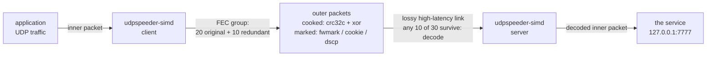
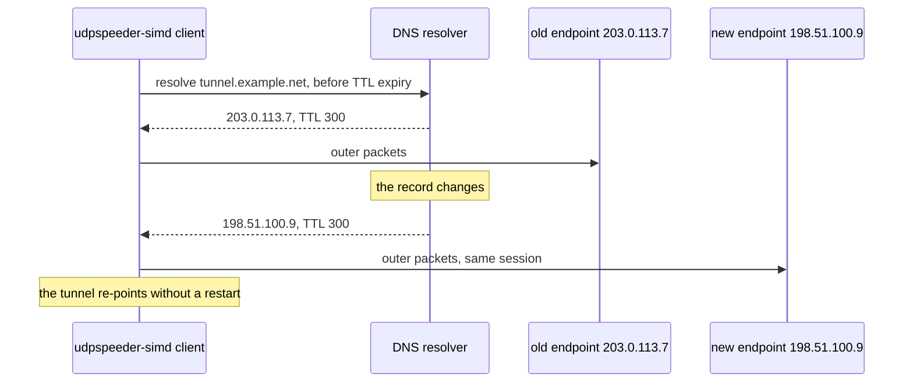
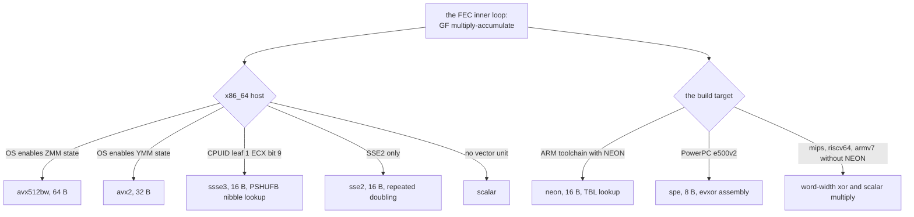

# The three mermaid blocks

Working material for `#author-the-mermaid-diagrams`. The blocks below are the
diagrams the two READMEs carry: the tunnel architecture with the marks drawn
on the outer packets, the endpoint re-point when DNS moves, and the SIMD
dispatch ladder. They are mermaid in the markdown, so they render wherever
the README renders and version with the prose that explains them. No upstream
image remains referenced after the rewrite (the inventory's stale digest,
item seven).

## The tunnel, with the marks on the outer packets

The marks are host-local: they ride the tunnel's own outer packets and change
how those are routed, filtered, or queued. The inner packet is untouched; the
two ends need not agree on any mark.

## The endpoint re-point when DNS moves

The client's `-r` takes a hostname. The lease manager refreshes the record
before its TTL expires and re-points the tunnel when the address changes, so
a moving endpoint never reads as an outage.

## The SIMD dispatch

On x86 the kernel ladders resolve at startup by CPUID probe; on the feed
targets the build decides. Every leaf below is a row CI holds as a check
under a named QEMU CPU model.

## Notes for the README assembly

- The blocks carry no upstream images and no image files; the rewrite deletes
  every `/images/` reference the inventory listed.
- Ink discipline: each diagram names its actors and its claim, nothing more;
  the numbers live in the adjacent tables, not inside the boxes.
- The dispatch diagram's leaves are the arch-map rows verbatim, so the
  diagram and the CI check cannot drift apart silently.
